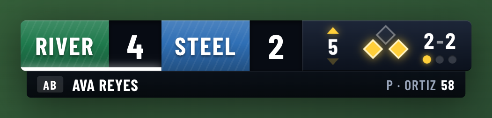

# Scoreboard

[](https://github.com/Sawdizzle/scoreboard/actions/workflows/check.yml) [](LICENSE)

Score the game once, on your phone. The scorebug on your live stream, your team's season stats and a public page for the parents all come from the same taps.

Scoreboard is built for youth sports streamed with OBS (or any streaming software that takes a web page as a source). Baseball has the deepest pad, with player stats; football, soccer, basketball and volleyball are scored in full, situation and clock included. The stream page is a transparent 1920×1080 Browser Source that keeps its last picture through a dropped connection instead of going blank.

<p align="center"><br /><sub>The stream: here the Prime Time scorebug, one of fourteen looks</sub></p>

## What v5 is

v5 is Scoreboard rebuilt around the team. v4 (tag [`v4.47`](https://github.com/Sawdizzle/scoreboard/tree/v4.47)) scored one game at a time for one account; v5 keeps everything the stream did and adds:

- **Teams with five staff seats** (organizer, head coach, coach, scorer, media), filled by invite links.
- **Rosters, seasons and player stats.** Every play names its batter and pitcher, so season lines (AVG, OBP, SLG, ERA, WHIP, W/L/SV) build themselves from scored games, on top of a GameChanger season import.
- **Public team pages**: schedule and results, season stats, the roster, and a live page for every game, with each player shown the way the staff chose (full name, first name and initial, or number only).
- **Stat cards from the scorebug**: batter, pitcher, due up, leaders, box score, lineup, defense, matchup, sponsor and the mid-inning board slide out from behind any look.
- **The Stream screen**: every look, layout, theme, sound and position setting in one place, over a live preview.

Everything v4 did on the stream is here too: the fourteen looks (Scoreboard's own, Classic, Prime Time, Blue Steel, Forever 20, Midnight, MLBFox, Classic Green, Pinball, Chalkboard, Comic, Split Flap, Receipt, Pixel RPG), v4's seventeen themes and five layouts with custom colours, synthesized sound in five packs, the walk-off and other stingers, Starting Soon, Final and Game paused scenes with venue weather, the announcement ticker, rotating sponsors, the on-air spots for our other apps, and OBS control from the pad.

v4's links keep working: `/control` opens the teams, `/overlay?ch=<token>` reaches the same stream, and `/recap?game=<id>` lands on that game's public page.

## Get your own

Scoreboard runs on a free Supabase project and Vercel. Setup takes about twenty minutes.

[](https://vercel.com/new/clone?repository-url=https%3A%2F%2Fgithub.com%2FSawdizzle%2Fscoreboard&project-name=scoreboard&repository-name=scoreboard&env=NEXT_PUBLIC_SUPABASE_URL,NEXT_PUBLIC_SUPABASE_PUBLISHABLE_KEY&envDescription=Your%20Supabase%20project%20URL%20and%20publishable%20key)

1. **Create a Supabase project** for this app alone. The publishable key ships to every browser; RLS keeps everyone out of Scoreboard's data, but another app sharing the project would share the key.
2. **Apply the schema**: every file in `supabase/migrations/`, in filename order (the SQL editor, or `supabase db push` with the CLI linked to your project). It creates the tables in `public`, their policies, and the `team-logos` Storage bucket. `supabase/legacy/` is v4's schema and is not needed for a new project.
3. **Auth → URL Configuration**: set the Site URL to your site, and add `https://<your-site>/**` to the Redirect URLs. Sign-up confirmation and password reset emails return there. Supabase's built-in email sender is rate-limited; for more than a handful of staff, add your own SMTP under Auth → Emails.
4. **Deploy**: the button above, or any Next.js host. Set `NEXT_PUBLIC_SUPABASE_URL` and `NEXT_PUBLIC_SUPABASE_PUBLISHABLE_KEY` (Project Settings → API). Locally, copy `.env.example` to `.env.local`.
5. **Optional, an invite code**: anyone who finds the site can create an account. To require a code, set one in SQL and switch on the hook:
   ```sql
   insert into private.settings (key, value) values ('invite_code', 'your-code')
   on conflict (key) do update set value = excluded.value;
   ```
   then Authentication → Hooks → Before User Created → Postgres function `public.hook_before_user_created`. Staff invite links always get through.

## Your first game

1. **Create an account** at `/sign-up` and confirm the email. On a phone, Share → **Add to Home Screen** opens Scoreboard full screen.
2. **New team**: name, short code and age group; then the logo (its colours are read from it), the roster (type, paste a list, or import a GameChanger season export), and a season.
3. **Invite your staff** from Staff: up to five seats, each a one-use link.
4. **New game**: pick an opponent you have played (their last lineup comes along), another team on Scoreboard, or type a name. Set the start time, the venue, a ZIP or town for the weather, and the rules (time limit, run rule, period length).
5. **Lineups**: tap players from the bench into the order, tap a spot on the field and then the player, or punch in the jersey numbers from the lineup card on the keypad.
6. **Stream**: copy the Browser Source link from the Stream screen into OBS once (next section). It follows whichever game the pad is scoring.
7. **Score** from the pad. It keeps the screen awake, saves every tap in order through a weak signal, and a second phone on the same game stays in step.

## OBS setup

1. **Sources → + → Browser**, URL the Stream screen's link, **1920 × 1080, 30 FPS**. The page is already transparent.
2. Uncheck **Shutdown source when not visible**, and check **Control audio via OBS** so the sounds reach the stream.
3. **Page permissions** decide how much of OBS the pad may drive; with none, everything on the stream still runs.

   | Page permissions | Adds |
   | --- | --- |
   | No access | The scorebug, cards, scenes, moments and sound |
   | Basic | Save replay, and auto-clip of big moments |
   | Advanced | Cameras (OBS scenes) and the replay buffer |
   | Full | Go live and record |

4. **Cameras**: one OBS scene per camera, each with the same Scorebug source added through **Add Existing**. Never a second copy: two sources mean doubled sound and two clips per replay.
5. **Replay buffer**: Settings → Output → Replay Buffer at 90 seconds. Auto-clip waits for the celebration before saving (a minute after a walk-off).

Place and size the bug on the Stream screen (nine positions and a size slider), not by stretching the source.

## Scoring

**Baseball**: BALL, STRIKE, FOUL and IN PLAY as full-height keys; MORE for hit by pitch, catcher's interference, intentional walk and balk; tap a runner for a steal, caught stealing, pick-off or advance. Ball four pushes the forced runners and offers **Fix runners**. In play asks what happened, who fielded it and where everyone ended up, pre-filled with the likely result. **Undo** takes back the last play and its stats, as many times as you like. The count bar opens **Fix the situation**: score, inning, outs, count, pitch count, hits and errors, bases, the batter, the time-limit clock, **Demo** (the game plays itself, for trying the stream), End game and Start over. On a laptop: B S F I M U, and 1 2 3 H E for hits.

**Football**: possession, downs and distance, touchdown, PAT and two-point try, field goal, safety, turnover, kickoff, timeouts, quarters and the quarter clock. **Soccer**: goals, cards, halves, stoppage time and a count-up match clock. **Basketball**: one, two and three, team fouls with the bonus, timeouts, periods and the clock. **Volleyball**: rally points with the serve, aces, sets to 25, 21 or 15.

## On Air

**On Air** on the pad is what is on the stream right now:

- **Cards**: batter, pitcher, due up, leaders, box score, lineup, defense, matchup, mid-inning, sponsor. The batter card can pop for each new batter, and the mid-inning board comes up by itself at the third out.
- **Moments**: Walk-off, Home run, Charge!, Double play (and each sport's own), once per tap; **Rally** is a glow that stays until turned off. Plays call their own moments as they are scored.
- **Scenes**: Starting Soon (countdown and the venue's weather), Final (who won and how), Game paused (lightning, rain, weather, suspended, called, with a countdown and a storm; New strike restarts the thirty minutes with a flash and thunder).
- **Ticker**: a message along the bottom, with an alert tone.
- **Intros**: the Blue Steel, Midnight and Forever 20 looks' own full-frame openings.
- **OBS**: the permission tier the source is on, Save replay, auto-clip, Go live, Record, the buffer, and the cameras.
- **Spots** for our other apps: a quick banner or a full-screen spot.

## Development

```
npm install
cp .env.example .env.local
npm run dev                  # http://localhost:3000
npm test                     # rules, stats, and every migration on an in-process Postgres
npm run typecheck
npm run lint
npm run build
```

`/dev/kit` draws every screen from made-up data with no database: `?v=today`, `roster`, `player`, `season`, `staff`, `game`, `lineup`, `pad`, `scorepad&sport=football`, `stream`, `public-game`, and `?v=overlay` for the stream over a stand-in camera (`&look=primetime`, `&card=batter`, `&theme=retro&style=scorebox`, `&sport=football`, `&status=final`). It returns 404 in a production build.

| Path | What it is |
| --- | --- |
| `supabase/migrations/` | The schema, named by the version the live project recorded. Tests apply every file to PGlite and check each rule as the role a real request arrives as |
| `app/actions.ts`, `lib/data.ts` | Every write (as the signed-in user; Postgres policies decide) and every read |
| `lib/rules/` | v4's rules engines, carried over unchanged with their tests: baseball (`logic.js`, `roster.js`), football, soccer, basketball, volleyball |
| `lib/scoring.ts`, `lib/stats.ts`, `lib/gamechanger.ts` | Who a play was about and what it added to their line; rates from counts; GameChanger imports |
| `lib/onair.ts`, `lib/broadcast.ts` | What the stream says, and its settings, commands and clocks |
| `components/pad/` | The pads, On Air, the game clock and the OBS panel |
| `components/overlay/` | The Browser Source (`/overlay/<token>`): `Stage` draws the feed, `Scenes` the full-frame scenes and ticker, `Fx` the stingers, `ObsBridge` OBS |
| `components/overlay/looks/` | The looks, one component and stylesheet each on the `BugProps` contract. Scope every selector under the look's root class: generic names leak |
| `components/overlay/themes.css` | v4's themes and layouts for Scoreboard's own bug |
| `lib/fx/` | v4's sound engine and weather, carried over unchanged |
| `public/bugs/`, `public/ads/` | v4's bug pages (reference and thumbnails, at `/bugs`) and the on-air spots |

## How it works

- **A play is one transaction.** `apply_play` writes the game's new state, a log entry with the state before it (so Undo is exact), and one stat row per player it touched. A play sent against an older version of the game is refused, so two phones can never write over each other.
- **The stream has no account.** It reads everything through `overlay_feed(token)`, which returns only a version stamp when nothing has changed, so a page left running all afternoon costs next to nothing. The pad nudges it over Realtime after each save; it also polls.
- **Names follow the staff's choice.** The public reads rosters and games through functions that apply each player's public-name setting; lineups are staff-only tables.
- **Settings merge, commands stamp.** Broadcast settings change key by key (`set_broadcast`), so two people never undo each other; a moment or an OBS action is a stamped command (`send_cmd`) the stream acts on once.
- **OBS is driven from inside OBS.** The pad cannot reach it; the stream page can, through `window.obsstudio`, and reports back by its token.

## License

MIT, see [LICENSE](LICENSE). The fonts Barlow Condensed, Martian Mono and Anton are under the SIL Open Font License (`public/fonts/OFL*.txt`).
